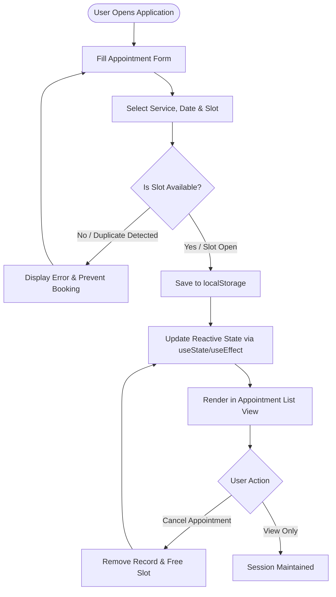

# 📅 Appointment Optimization & Scheduling

[](LICENSE)
[](https://react.dev/)
[](https://developer.mozilla.org/en-US/docs/Web/JavaScript)
[](https://developer.mozilla.org/en-US/docs/Web/HTML)
[](https://developer.mozilla.org/en-US/docs/Web/CSS)
[](#system-architecture)
[](#academic-information--team)

> **A modern, intuitive, and conflict-free digital appointment scheduling system designed to streamline booking, prevent double bookings, and simplify schedule management.**

---

## 📖 Table of Contents

- [Overview](#-overview)
- [Problem Statement](#-problem-statement)
- [Key Features](#-key-features)
- [System Architecture & Workflow](#-system-architecture--workflow)
- [Tech Stack](#-tech-stack)
- [Testing & Quality Assurance](#-testing--quality-assurance)
- [Roadmap & Future Enhancements](#-roadmap--future-enhancements)
- [Academic Information & Team](#-academic-information--team)
- [Getting Started](#-getting-started)
- [License](#-license)

---

## 🌟 Overview

**Appointment Optimization & Scheduling** is a web-based scheduling solution developed as part of **Mini Project – 1 (Semester V)** under the **Department of Computer Engineering & Applications at GLA University**. 

In conventional scheduling workflows, booking appointments often involves manual logs, overlapping reservations, opaque slot availability, and tedious cancellation procedures. This application addresses these bottlenecks by offering a responsive, component-driven booking portal that dynamically verifies slot availability, eliminates scheduling conflicts, and provides real-time appointment tracking and cancellation.

The current implementation provides a lightweight, client-side, zero-backend architecture powered by **React.js** and browser **`localStorage`**, paired with an architectural design path for full-stack deployment using **Node.js, Express.js, and MongoDB**.

---

## ❗ Problem Statement

Traditional appointment scheduling systems suffer from:
- 🚫 **Double Bookings & Collisions**: High frequency of overlapping appointments due to lack of automated slot validation.
- 🕒 **Opaque Availability**: Inability for users to check open vs. reserved slots for a specific date in real time.
- 📋 **Inefficient Manual Record Keeping**: Paper records and disjointed spreadsheets that lead to human error and data loss.
- 📉 **Poor User Experience**: Complex or non-existent self-service cancellation and tracking for clients.

### 🎯 Project Objectives
1. **User-Friendly Booking**: Design a clean, responsive interface to reserve appointments effortlessly.
2. **Dynamic Slot Availability**: Provide live slot status for any chosen service and date.
3. **Collision & Conflict Prevention**: Enforce strict client-side validation to block duplicate bookings.
4. **Persistent State Management**: Guarantee immediate persistence of scheduled appointments across sessions via browser storage.
5. **Appointment Lifecycle Management**: Enable users to view, monitor, and cancel appointments with immediate state updates.

---

## ✨ Key Features

| Feature | Description |
| :--- | :--- |
| **📝 Smart Booking Form** | Captures essential user details (Full Name, Email Address, Contact Number) along with required Service, Appointment Date, and Time Slot. |
| **⚡ Real-Time Conflict Detection** | Automatically validates slot availability for the selected date and blocks duplicate reservations before submission. |
| **📋 Appointment Dashboard** | Displays all active appointments with detailed service metadata, date, time, and patient/client credentials. |
| **❌ Self-Service Cancellation** | Allows users to cancel scheduled appointments on demand, immediately releasing the slot back to the available pool. |
| **💾 Persistent Storage** | Leverages browser `localStorage` for fast, zero-latency persistence without external database dependencies. |
| **📱 Responsive UI Design** | Built with component-driven architecture and responsive CSS/Bootstrap for seamless experience across mobile, tablet, and desktop viewports. |

---

## 🏗 System Architecture & Workflow

The system is architected for zero-friction client execution while maintaining separation of concerns between presentation, business logic, and persistence layers.

### Application Workflow



### Architecture Breakdown
1. **React Components Layer**: Interactive UI components render input forms, date pickers, slot selectors, and the active appointments table.
2. **Application Logic Layer**: Validates form inputs, compares requested slots against existing records, and enforces scheduling constraints.
3. **Data Persistence Layer**: Synchronizes appointment objects with browser `localStorage`, ensuring data durability across page reloads.

---

## 🛠 Tech Stack

### Core Implementation (Frontend)
- **Library/Framework**: [React.js](https://react.dev/) (Component-based architecture)
- **State Management & Hooks**: `useState` (component state & form handling), `useEffect` (data synchronization & lifecycle management)
- **Markup & Styling**: HTML5, CSS3, Bootstrap & Custom Modern UI styling
- **Storage**: Browser `localStorage` Web API
- **Tooling**: [VS Code](https://code.visualstudio.com/), Git & GitHub

### Full-Stack Roadmap Architecture
- **Backend Runtime**: [Node.js](https://nodejs.org/)
- **Web Framework**: [Express.js](https://expressjs.com/) (RESTful API endpoints)
- **Database**: [MongoDB](https://www.mongodb.com/) (Document store)
- **Object Data Modeling (ODM)**: [Mongoose](https://mongoosejs.com/)

---

## 🧪 Testing & Quality Assurance

The application underwent rigorous verification covering key operational areas:

- [x] **Form Validation**: Verification of input format constraints (valid email syntax, 10-digit telephone numbers, non-empty fields).
- [x] **Time-Slot Availability**: Validation of availability matrix across selected dates and services.
- [x] **Conflict & Duplicate Booking Prevention**: Tested concurrent and duplicate booking attempts on identical date-slot tuples.
- [x] **Creation & Cancellation Flow**: Verified state transitions when booking is finalized and when cancellation is invoked.
- [x] **Persistence Verification**: Confirmed retention and retrieval of records across browser restarts and page refreshes using `localStorage`.

---

## 🚀 Roadmap & Future Enhancements

- 🔐 **Authentication & Authorization**: User registration, login, and Role-Based Access Control (RBAC) for Admins and Clients.
- 📊 **Admin Dashboard**: Analytics panel displaying booking trends, peak hours, and appointment throughput.
- 🔄 **Rescheduling Engine**: Seamless self-service slot modification without requiring cancellation.
- 📩 **Automated Notifications**: Email and SMS reminders via Twilio and Nodemailer for booking confirmations and reminders.
- 💳 **Online Payment Integration**: Payment gateways (Stripe / Razorpay) for paid consultations and deposits.
- 📆 **Calendar Synchronization**: Bi-directional integration with Google Calendar, Outlook, and iCal.
- 👨‍⚕️ **Multi-Provider Support**: Scheduling across multiple practitioners, doctors, or service specialists.
- ☁️ **Cloud Deployment**: Containerization with Docker and deployment on AWS/Vercel with MongoDB Atlas cloud database.

---

## 👥 Academic Information & Team

This project was developed and submitted in fulfillment of **Mini Project – 1**:

- **Institution**: **GLA University, Mathura**
- **Department**: Department of Computer Engineering & Applications
- **Course & Semester**: Mini Project – 1, Semester V
- **Batch & Section**: Batch No. 06 | Section 3SD
- **Date of Submission**: 18 September 2026
- **Faculty Mentor / Guide**: **Anurag Das**

### 🤝 Team Members & Contributions

| S.No. | Student Name | University Roll No. | Primary Role & Responsibility |
| :---: | :--- | :---: | :--- |
| 1 | **Krishna Upadhyay** | `2415000849` | **Frontend Development** (UI Layout, Components & Styling) |
| 2 | **Kshma** | `2415000859` | **Database Management** (Data Schema, Persistence & Records) |
| 3 | **Lakshya Agrawal** | `2415000887` | **Testing & Documentation** (Quality Assurance, Repo Setup & Docs) |
| 4 | **Maan Pratap Singh** | `2415000906` | **Backend & API** (API Design & Server Logic Integration) |
| 5 | **Mayank Dhakre** | `2415000955` | **Research & Presentation** (Requirement Analysis & Slide Deck) |

---

## 💻 Getting Started

### Prerequisites
- Modern Web Browser (Chrome, Firefox, Edge, Safari)
- [Node.js](https://nodejs.org/) (v16.0.0 or higher recommended) & `npm` (for React build workflow)
- [Git](https://git-scm.com/) installed on your machine

### Clone & Setup

1. **Clone the repository:**
   ```bash
   git clone https://github.com/SecuVortex/Appointment-Optimization-Scheduling.git
   cd Appointment-Optimization-Scheduling
   ```

2. **Explore Project Files:**
   - `Batch 6 Project_Synopsis (1).pdf` — Official Academic Project Synopsis.
   - `Presentation  Batch 06.pptx` — Final Presentation Slide Deck.
   - `README.md` — Project specification and architecture documentation.

---

## 📄 License

This project is licensed under the [MIT License](LICENSE) — see the LICENSE file for details.
